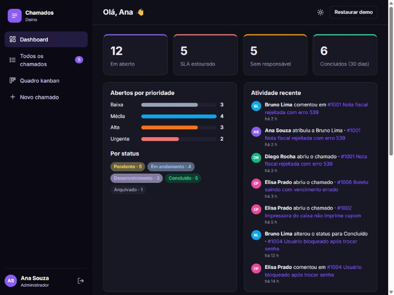
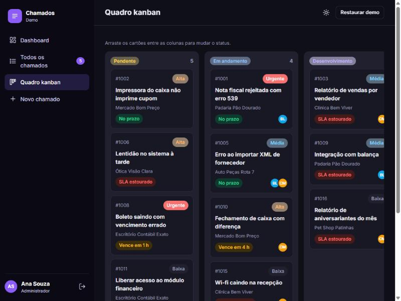

<div align="center">

# 🎫 Sistema de Chamados · Demo

**Help desk completo rodando direto no navegador: dashboard, kanban, SLA, checklist e linha do tempo.**

[](https://heitorperdigao.github.io/sistema-de-chamados-demo/)



</div>

---

## 💡 Sobre

Versão de demonstração de um **sistema de chamados** que desenvolvi e que é usado em produção por uma empresa de software em Londrina-PR.
O sistema real é privado (PHP + PostgreSQL, com dados de clientes). Esta demo recria as principais funcionalidades **do zero, com dados 100% fictícios**, para que qualquer pessoa possa testar sem instalar nada.

**Entre com um dos 3 perfis** e veja como as permissões mudam o que cada um pode fazer:

| Perfil | O que pode fazer |
|---|---|
| 👩‍💼 **Administrador** | Vê todos os chamados, atribui responsáveis, muda status e prioridade |
| 🧑‍🔧 **Responsável** | Atende chamados e move os cartões no quadro kanban |
| 🙋 **Usuário** | Abre chamados e acompanha só os próprios |

## ✨ Funcionalidades

- **Dashboard** com indicadores (em aberto, SLA estourado, sem responsável, concluídos) e feed de atividade
- **SLA por prioridade**: urgente 4 h, alta 24 h, média 72 h, baixa 7 dias, com selo "no prazo / vence em breve / estourado"
- **Quadro kanban** com arrastar e soltar para mudar o status
- **Página do chamado** com checklist e barra de progresso, etiquetas, vários responsáveis e comentários
- **Linha do tempo** que registra automaticamente toda alteração (status, prioridade, responsáveis, checklist)
- **Busca sem acento e sem diferenciar maiúsculas**: "aliquota" encontra "alíquota"
- **Tema claro e escuro**, layout responsivo para celular e **impressão/PDF** do chamado
- **Segurança no front**: todo texto do usuário é escapado (sem XSS), sem `alert()`/`confirm()` nativos (toasts e modais próprios)

## 📸 Telas

| Quadro kanban | Chamado |
|---|---|
|  |  |

## 🛠️ Tecnologias


HTML, CSS e **JavaScript puro**, sem framework e sem build. Roteamento por hash, estado em `localStorage` e componentes renderizados por template strings.
Publicado com **GitHub Pages**.

## 🚀 Rodar localmente

```bash
npx serve .
```

> Os dados ficam salvos só no seu navegador. O botão **Restaurar demo** volta tudo ao estado inicial.

---

<div align="center">

Desenvolvido por **[Heitor Perdigão](https://github.com/heitorperdigao)** · [NoxusSoft](https://noxussoft.com.br)

</div>
