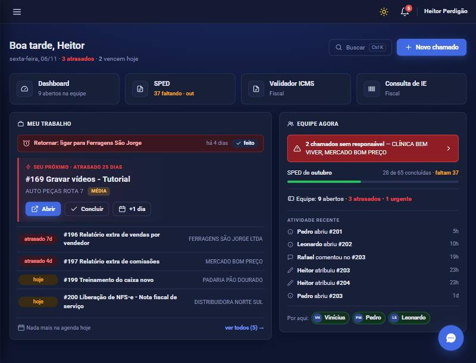
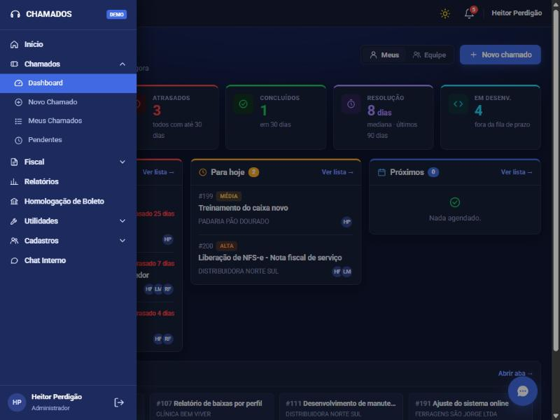

<div align="center">

# 🎧 Sistema de Chamados · Demo

**Gestão de chamados para equipes de suporte: fila de trabalho por prazo, dashboard da equipe, checklist e linha do tempo.**

[](https://heitorperdigao.github.io/sistema-de-chamados-demo/)



</div>

---

## 💡 Sobre

Versão pública de demonstração de um **sistema de chamados que desenvolvi e que está em produção** em uma empresa de software de Londrina-PR, usado diariamente pela equipe de suporte.

O sistema real é privado (PHP + PostgreSQL, com dados de clientes e módulos fiscais). Esta demo recria **o módulo de Chamados com o mesmo visual e o mesmo fluxo de trabalho**, do zero e **com dados 100% fictícios**, para que qualquer pessoa possa testar sem instalar nada.

Entre com um dos perfis e veja como as permissões mudam o que cada um vê:

| Perfil | O que pode fazer |
|---|---|
| 👨‍💼 **Administrador** | Vê a equipe toda, atribui responsáveis, muda status, prioridade e prazo |
| 🧑‍🔧 **Responsável** | Trabalha a própria fila e atende os chamados atribuídos |
| 🙋 **Usuário** | Abre chamados e acompanha só os que abriu |

## ✨ Funcionalidades

- **Início** com saudação, contagem de atrasados e "vencem hoje", e o card **Seu próximo**: o chamado mais urgente da sua fila, com Abrir, Concluir e **+1 dia**
- **Equipe agora**: alertas (chamados sem responsável), progresso do mês, totais da equipe, atividade recente e quem está online
- **Dashboard** com visão **Meus / Equipe**, indicadores (abertos, atrasados, concluídos em 30 dias, mediana de resolução, em desenvolvimento) e colunas **Atrasados**, **Para hoje**, **Próximos** e **Em desenvolvimento**
- **Página do chamado** com status, prioridade, prazo, vários responsáveis, etiquetas, checklist com progresso e comentários
- **Linha do tempo automática**: toda alteração fica registrada com autor e horário
- **Busca rápida com Ctrl + K** e busca que **ignora acentos** ("aliquota" encontra "alíquota")
- **Menu lateral em acordeão**, tema escuro e claro, layout para celular e impressão do chamado
- **Segurança no front**: todo texto do usuário é escapado (sem XSS) e nada de `alert()`/`confirm()` nativos

## 📸 Telas

| Dashboard | Chamado |
|---|---|
|  |  |

| Menu lateral |
|---|
|  |

## 🛠️ Tecnologias


HTML, CSS e **JavaScript puro**, sem framework e sem build: roteamento por hash, estado em `localStorage` e telas renderizadas por template strings. Publicado no **GitHub Pages**.

> No sistema real: PHP, PostgreSQL, Bootstrap 5, notificações em tempo real (SSE), chat interno, módulos fiscais (SPED, ICMS, IE, NCM) e central de relatórios.

## 🚀 Rodar localmente

```bash
npx serve .
```

Os dados ficam salvos só no seu navegador. Use **Restaurar dados da demo**, no menu lateral, para voltar ao estado inicial.

---

<div align="center">

Desenvolvido por **[Heitor Perdigão](https://github.com/heitorperdigao)** · [NoxusSoft](https://noxussoft.com.br)

</div>
